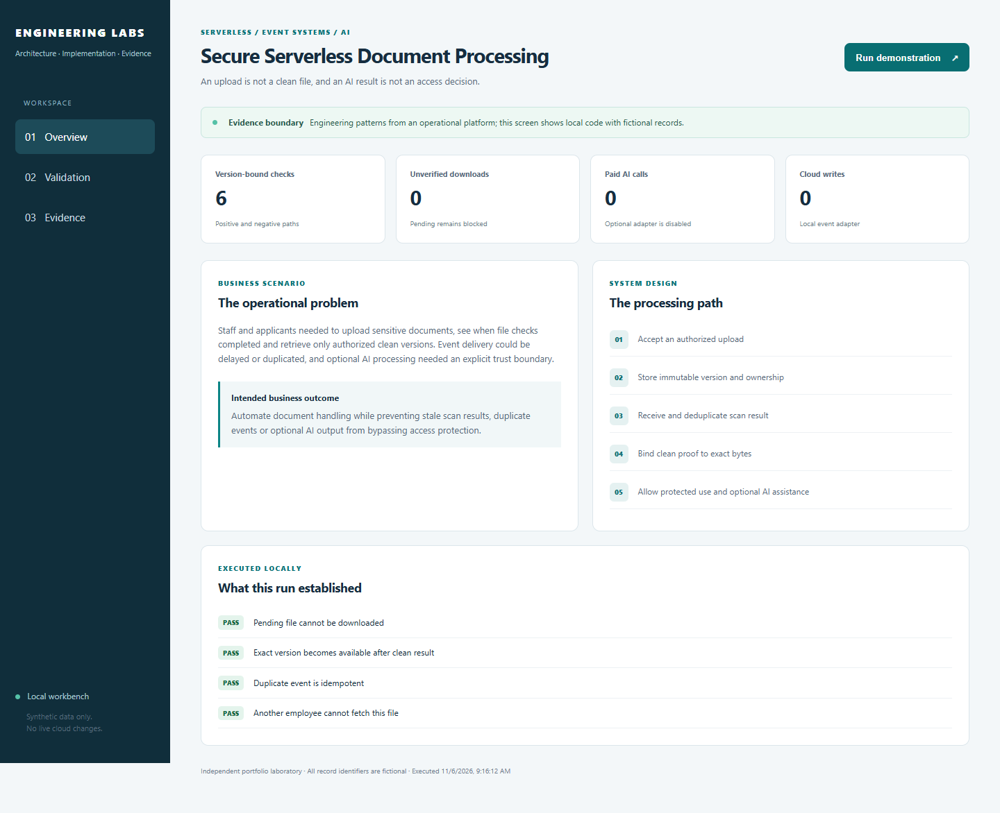
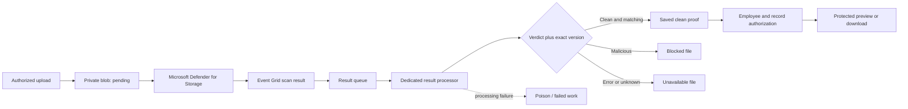
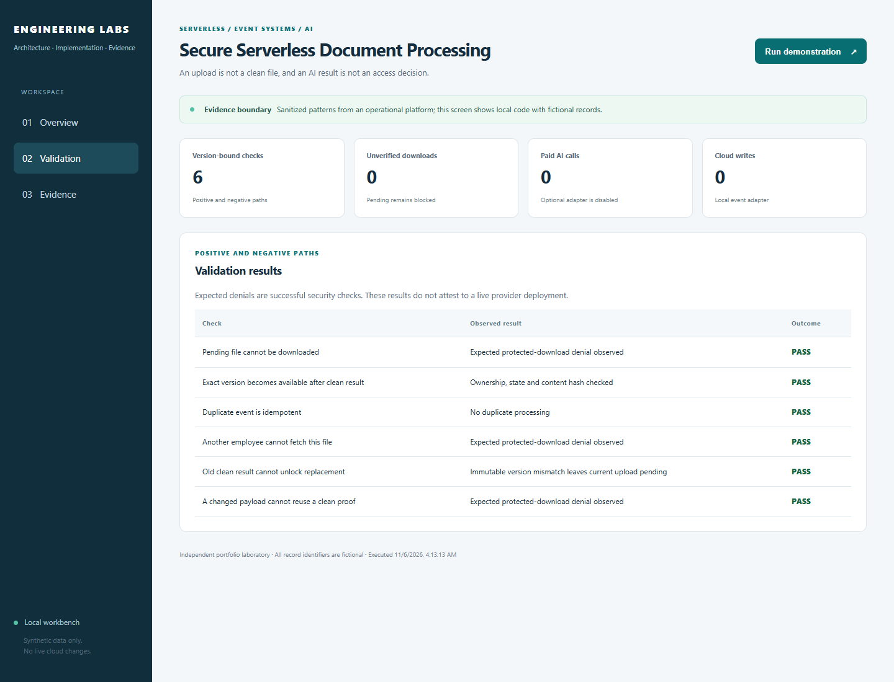

# Azure Malware Scanning & File Quarantine

**Keep uploaded files unavailable until the correct file version passes its malware check.**

[The problem](#the-business-problem) · [The solution](#the-solution) · [What was built](#what-was-built) · [Proof it works](#proof-it-works) · [Commands](docs/COMMANDS.md) · [Step by step](#step-by-step)



## The Business Problem

Applicants and employees upload documents into the platform. An upload being accepted does not mean the file is safe. A scan result may arrive late, arrive more than once, or describe an older file that has already been replaced.

## The Solution

Use Microsoft Defender for Storage to scan uploads. Send the results through Event Grid and a queue to a dedicated processor. Match the result to the exact file version, then check the user’s permission before allowing a preview or download.

**Business outcome:** Reduce the risk of sharing unsafe or unchecked files while giving staff a clear scan status and a way to recover failed processing.

### Actual implementation

This case study comes from the workforce platform I built and operated. It includes selected implementation source and executable tests, related Terraform and operational lessons. The public examples omit employee records, credentials, cloud IDs and private source documents.

- Integrated Defender for Storage scan results with Event Grid, queues and a dedicated Azure Functions processor.
- Bound saved clean-scan results for the exact files to the exact uploaded file and authorized employee/record before previews or downloads.
- Added visible upload/file-check status and documented recovery when the processor is stopped or events fail.

The included local preview is a reproducible example. It does not replace actual nonproduction portal acceptance. [The evidence guide](docs/VALIDATION.md) distinguishes source tests, local output and cloud observations.

## Step by Step

A short walkthrough of the process, with technical instructions and evidence limits in the sections below.

1. **Hold the new upload privately** — Save the uploaded file with a pending check status. Do not allow viewing merely because the upload completed.

2. **Receive the malware result** — Microsoft Defender for Storage produces a scan result for the file. Event Grid and a queue carry that result to the dedicated processor.

3. **Match the exact file** — The processor checks the result against the expected file and its change details. A result for an older or different file must not unlock the current upload.

4. **Allow access only when ready** — A matching clean result supports availability, but the user must still have permission to the record. Unsafe, failed or uncertain results leave the file unavailable.

## Architecture



## What Was Built

| Component | Role in plain words | Implementation |
| --- | --- | --- |
| Defender scan configuration | Defines the optional on-upload malware-scanning service and its result topic. | [View code](infra/events.tf) |
| Private holding area for unchecked files | Keep documents private and block access while a scan is pending, unsafe or unsuccessful. | [View code](lab/domain.py) |
| Event Grid and result/poison queues | Separate provider delivery from business requests and preserve failed work. | [View code](infra/events.tf) |
| Actual provider-result policy | The extracted TypeScript maps the exact clean verdict, malicious result and errors. | [View code](reference/scan-result-policy.ts) |
| Result journal and version checks | Handle duplicate/conflicting events and prevent old results from unlocking new bytes. | [View code](lab/domain.py) |
| Disabled worker foundation | Show the separate scan-result processor without starting it. | [View code](infra/processor.tf) |

## Proof It Works

Run from the repository root. Commands are explained in [the command reference](docs/COMMANDS.md).

### 1. The actual scan-result mapping fails closed

The source excerpt accepts the exact clean result, distinguishes malicious content, and maps errors/unknown values to an error state.

```bash
npm run test:source
```

**What to look for:** Six extracted source-policy tests pass. This exercises the mapping; it does not run Defender Antivirus.

### 2. Pending, malicious and failed files stay unavailable

The demonstration now includes all four file states and shows that ownership is checked even for a clean file.

```bash
python -B -m lab demo
```

**What to look for:** Eight checks pass. Records show a clean version, a pending replacement, a blocked malicious-verdict fixture and an error-verdict fixture.

### 3. Old or duplicate events cannot bypass protection

The local journal binds results to immutable versions and handles repeated events across separate connections.

```bash
python -B -m unittest discover -s tests -v
```

**What to look for:** Thirteen local tests cover ownership, exact bytes, stale results, conflicting replay, concurrent duplicate events and blocked-state protection.

### 4. Visible output

The workbench shows the executed checks and fictional records. Desktop/mobile views, rerun behavior and access restrictions were checked. See [dated validation](docs/VALIDATION.md) for scope and counts.



## Security Practices

- The detection engine is Defender for Storage. The Python program consumes fictional verdicts; it is not an antivirus engine.
- Quarantine here means private storage plus denied application retrieval. The reference does not automatically move or delete malicious blobs.
- A clean verdict does not grant access to another employee, and editable blob tags alone are not an authorization authority.
- The optional paid scan service, event delivery and worker shell are separate default-Off infrastructure choices.

The [security guide](SECURITY.md) explains trust boundaries. State, plans, credentials and local output stay out of Git.

## Run It Locally

Requires Python 3.12 and Node.js 22.18 or newer for the extracted TypeScript tests. The accepted source run used Node 22.23.2. No Node package installation is needed for the source tests.

```bash
python -m venv .venv
source .venv/bin/activate
python -m pip install -r requirements.txt
npm run test:source
python -B -m unittest discover -s tests -v
python -B -m lab demo
python -B -m lab serve --port 8011
```

Windows: use `.venv\Scripts\python.exe` for the Python commands and `npm.cmd` if PowerShell blocks `npm.ps1`. Open [the loopback workbench](http://127.0.0.1:8011). Stop it with Ctrl+C. The [walkthrough](docs/WALKTHROUGH.md) connects these commands to each processing step.

## Terraform Infrastructure

Private storage and containers, result/poison queues, Event Grid identity and optional Defender on-upload scanning. The optional Functions Flex shell is Disabled. Host-storage separation, exact RBAC, SQL adapters and private caller routes remain explicit commissioning dependencies.

```bash
terraform -chdir=infra init -backend=false -input=false
terraform -chdir=infra fmt -check -recursive
terraform -chdir=infra validate
terraform -chdir=infra test
```

These are local schema/mock-plan checks, not a cloud apply. Read [the infrastructure guide](infra/README.md) and [example inputs](infra/example.tfvars.example) before any separate commissioning.

## Scaling and Tradeoffs

Measure oldest pending upload, result delivery lag, poison-queue growth and replay conflicts. Increase processor concurrency only after testing per-file state transitions and database contention. Keep the scan service and result processor independently observable.

Read [strengths, weaknesses and tradeoffs](docs/SCALING.md) for the operating decisions.

## Skills Demonstrated

- Microsoft Defender for Storage
- Azure Functions, Event Grid and queues
- Malware-result handling and file quarantine
- Version binding, protection against repeating the same action and protected downloads
- Terraform, failure recovery and operational visibility

## Project Guides

| Guide | Purpose |
| --- | --- |
| [Architecture](docs/ARCHITECTURE.md) | Follow the actual service and trust boundaries |
| [Walkthrough](docs/WALKTHROUGH.md) | Understand the steps and run the commands |
| [Command reference](docs/COMMANDS.md) | Copy commands and check expected results |
| [Validation evidence](docs/VALIDATION.md) | Separate completed checks from work still needing real-service testing |
| [Operations](docs/OPERATIONS.md) | Troubleshoot failure stages and recover safely |
| [Source map](docs/SOURCE-MAP.md) | See actual extracted code versus public reference adapters |
| [Screenshot plan](docs/SCREENSHOT-PLAN.md) | Capture actual nonproduction portal/terminal evidence later |
| [References](docs/REFERENCES.md) | Technical sources and presentation credits |

## Cost and Cleanup

Local demos and source tests do not start Azure resources or make paid provider requests. Cloud scanning, image editing, storage and any commissioned runtime can incur charges. The manual CI workflow is not dispatched automatically. Stop the local server and inspect `git status --short --ignored` before removing only your own temporary output. Real cloud activation or cleanup is separate.
