# Secure Serverless Document Processing

**An upload is not a clean file, and an AI result is not an access decision.**

[The problem](#the-business-problem) · [The solution](#the-solution) · [What was built](#what-was-built) · [Proof it works](#proof-it-works) · [Run it](#run-it-locally)


## The Business Problem

Staff and applicants needed to upload sensitive documents, see when file checks completed and retrieve only authorized clean versions. Event delivery could be delayed or duplicated, and optional AI processing needed an explicit trust boundary.

1. **Upload success mistaken for availability.** A file can be accepted while its malware check is still pending or failed.
2. **Old results applied to new bytes.** A delayed clean verdict must not unlock a replacement file.
3. **Duplicate events or wrong-person access.** Event delivery can repeat, and a clean file still belongs to its authorized record.

## The Solution

Record ownership and immutable file identity at upload, process scan results through a separate event path, and allow protected use only when the clean proof matches the current file. Keep optional AI assistance outside the access and malware decisions.

**Business goal:** Automate document handling while preventing stale scan results, duplicate events or optional AI output from bypassing access protection.

### Platform implementation

- Centralized document handling through Azure Functions, private storage and authorized staff/applicant access paths, including legacy-source ingestion patterns using Logic Apps.
- Built a dedicated scan-result processor, separate from ordinary business requests, with event/container routing, clean-file proofs and protected downloads.
- Added visible file-check states across upload areas so upload acceptance and clean-file availability were distinct outcomes.
- Implemented employee badge portrait preparation with optional AI assistance, fixed-template rendering and protected employee views; kept original identity documents separate from derived artifacts.

This case study draws on a workforce/operations platform I designed and implemented. Organization details and records are excluded. The public code makes selected patterns reproducible; the screenshots show a working local demonstration with fictional data. [Validation scope](docs/VALIDATION.md) separates that evidence from provider-side acceptance.

## Architecture

```mermaid
flowchart LR
  User[Staff or applicant] --> API[Authorized upload API]
  API --> Blob[(Private immutable file)]
  Blob --> Scan[Defender malware scan]
  Scan --> Event[Event Grid result]
  Event --> Queue[(Result queue / dead letter)]
  Queue --> Processor[Separate scan processor]
  Processor --> Proof[(Version-bound clean proof)]
  Proof --> Download[Protected file view]
  Download -. optional approved input .-> AI[AI assistance]
```



## What Was Built

| Component | Role in plain words | Implementation |
| --- | --- | --- |
| Private intake and deployment containers | Define keyless storage, file versioning and protected containers through ARM. | [View code](infra/storage.tf) |
| Result and poison queues | Separate ordinary scan events from failed processing work. | [View code](infra/events.tf) |
| Event Grid and optional scan configuration | Use a managed-identity topic and separate default-Off choices for delivery and paid Defender scanning. | [View code](infra/events.tf) |
| Disabled Functions Flex shell | Show the infrastructure boundary without publishing a worker package or activating it. | [View code](infra/processor.tf) |
| Version-bound processing journal | Handle duplicates and reject stale/conflicting events in the local reference. | [View code](lab/domain.py) |
| Provider result mapping | Preserve the operational TypeScript rule: only the exact clean verdict is clean. | [View code](reference/scan-result-policy.ts) |
| Optional structured AI adapter | Validate a bounded text-classification result; default demo makes no paid calls. | [View code](lab/ai.py) |

## Proof It Works

**Recorded checks:** 16 unit tests passed · 6 demonstration checks passed · 2 Terraform mock tests passed.

These are dated results for this reference implementation, not live Azure/AWS deployment claims. [Test record](docs/validation-results.json) · [Evidence and limitations](docs/VALIDATION.md)

### 1. Pending and wrong-person downloads are denied

The tests reject pending files and attempts by another employee. A clean state alone cannot bypass ownership.

Run from the repository root:

```bash
python -B -m unittest discover -s tests -p test_domain.py -v
```

**What to look for:** The suite includes pending-file and wrong-owner denials, exact-byte checks and mocked AI behavior.

### 2. A replacement cannot reuse an old clean result

The current upload becomes pending again. An event for the previous version is recorded as obsolete and cannot unlock it.

Run from the repository root:

```bash
python -B -m unittest discover -s tests -p test_domain.py -k stale_event -v
```

**What to look for:** The delayed result for an older file version cannot unlock the replacement.

### 3. Repeated events are handled safely

Concurrent connections replay the same event without duplicate processing. Conflicting reuse of an event ID is rejected; unknown provider results fail closed.

Run from the repository root:

```bash
python -B -m unittest discover -s tests -p test_concurrency.py -v
```

**What to look for:** Separate connections replay one event safely, and replacement cannot change the existing owner.

### 4. Visible results

The dashboard runs the same domain code as the CLI. Desktop/mobile rendering, all three tabs, rerunning the demonstration, cross-origin write rejection and unlisted-file rejection were checked. The screenshots are captured from those runs.


Expected access denials are successful negative tests. Cloud permissions, network connectivity and provider integrations need their own acceptance evidence.

## Security Practices

- The local events are fictional and are not malware-engine verdicts. Real Event Grid/queue authentication and storage routing require separate acceptance.
- The Functions shell remains Disabled. Application deployment, dedicated host-storage design, SQL permissions and exact host/data roles are integration steps.
- The optional AI adapter is disabled by default, validates a strict output shape and never determines identity, eligibility or file cleanliness.

State, saved Terraform plans, private inputs and credentials are excluded through [`.gitignore`](.gitignore). The existing validation workflow is manual-only and has no cloud deployment permission.

## Run It Locally

The [command reference](docs/COMMANDS.md) includes prerequisites, Windows equivalents, focused checks and evidence notes.

Requires Python 3.12 or newer. The default demonstration uses the Python standard library. Run inside a virtual environment:

```bash
python -m venv .venv
source .venv/bin/activate
python -m pip install -r requirements.txt
python -B -m unittest discover -s tests -v
python -B -m lab demo
python -B -m lab serve --port 8011
```

On Windows, use `.venv\Scripts\Activate.ps1` instead of the `source` command, or run `.venv\Scripts\python.exe` directly. Open [the local workbench](http://127.0.0.1:8011), choose **Run demonstration**, then review **Validation** and **Evidence**. Stop with Ctrl+C. No cloud login, employee data or paid API request is required.

## Terraform Infrastructure

Private intake/deployment containers, result and poison queues, a managed-identity Event Grid topic, optional Defender scan configuration and an optional disabled Functions Flex shell.

See the [Terraform code and validation steps](infra/README.md), [input example](infra/example.tfvars.example) and [mock plan tests](infra/tests). Cloud commissioning and any paid resources remain separate from the local demonstration.

Validate the infrastructure source without creating cloud resources:

```bash
cd infra
terraform init -backend=false
terraform fmt -check -recursive
terraform validate
terraform test
```

The tests use mock providers. Example inputs are placeholders, not deployment-ready values. Review the [integration boundaries and cost notes](infra/README.md) before any separate cloud commissioning.

## Scaling and Tradeoffs

Bound worker concurrency, monitor oldest pending work and isolate poison messages. Use durable per-file transitions, exact version binding and explicit replay procedures. Keep paid AI limits and unused-artifact retention separate from source-document retention.

See [strengths, weaknesses and tradeoffs](docs/SCALING.md) for the detailed decisions.

## Skills Demonstrated

- Azure Functions, Event Grid and storage queues
- Asynchronous processing and event deduplication
- Protected uploads and version-bound scan proofs
- Managed identities and trust boundaries
- Optional AI integration and failure handling

## Project Guides

| Guide | What you will find |
| --- | --- |
| [Command reference](docs/COMMANDS.md) | Copy the commands, understand their purpose and check expected results |
| [Implementation walkthrough](docs/WALKTHROUGH.md) | Follow the processing path and code |
| [Architecture](docs/ARCHITECTURE.md) | Understand service and identity boundaries |
| [Terraform](infra/README.md) | Read the resource map, input examples and integration steps |
| [Validation evidence](docs/VALIDATION.md) | Inspect dated checks and their limits |
| [Operations and troubleshooting](docs/OPERATIONS.md) | Diagnose failures and recover safely |
| [Security and privacy](SECURITY.md) | Review access, secrets and publication controls |
| [Scaling and tradeoffs](docs/SCALING.md) | Understand the costs of each design choice |
| [References](docs/REFERENCES.md) | See technical sources and presentation inspiration |

## Repository Map

```text
infra/               Terraform source, example inputs and mock plan tests
lab/                 Working reference implementation and loopback dashboard
tests/               Positive, negative and recovery cases
docs/                Architecture, walkthrough, evidence and operating guide
.github/workflows/   Manual-only contract validation; no cloud deployment
```

## Cost and Cleanup

The default local demo creates only temporary local state and makes no paid calls. Cloud examples are separate opt-in source and can create billable resources if an operator applies them. No automated deployment or destruction is configured. Use `git status --short --ignored` before cleanup; remove only your own `.venv` or disposable lab output. Never copy real state files, tokens or employee documents into this repository.
