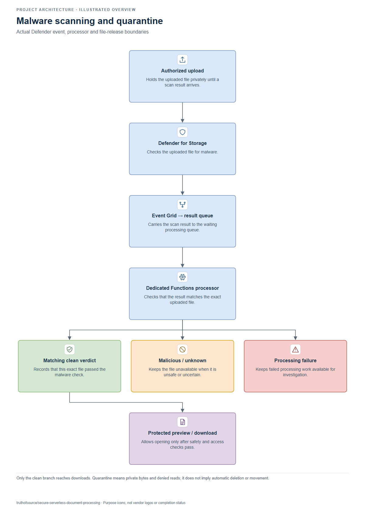

# Azure Malware Scanning & File Quarantine

[](docs/diagrams/architecture.svg)

[View SVG](docs/diagrams/architecture.svg) · [Download PNG](docs/diagrams/architecture.png) · [Edit in draw.io](docs/diagrams/architecture.drawio)

**Keep uploaded files unavailable until the correct file version passes its malware check.**

[The problem](#the-business-problem) · [The solution](#the-solution) · [What was built](#what-was-built) · [Proof it works](#proof-it-works) · [Commands](docs/COMMANDS.md) · [Step by step](#step-by-step)

## The Business Problem

Applicants and employees submit identity documents, employment forms and other files that HR needs to open during onboarding and administration. Accepting the upload makes the document available to the application, but it gives staff no reliable assurance that opening it is safe. Sharing an unchecked attachment can expose both the reviewer and the organization's systems.

The file check happens separately from the upload. Its result can arrive late, appear twice or refer to an older version that the user has replaced. If the application accepts the wrong result, it can release unchecked bytes; if processing stalls without a useful status, staff face blocked work and uncertain next steps.

The business need was to keep each file unavailable until its own trusted malware result is known, show meaningful progress and support recovery without manually declaring a file safe.

## The Solution

Use Microsoft Defender for Storage to scan uploads. Send the results through Event Grid and a queue to a dedicated processor. Match the result to the exact file version, then check the user’s permission before allowing a preview or download.

**Business outcome:** Reduce the risk of sharing unsafe or unchecked files while giving staff a clear scan status and a way to recover failed processing.

### Actual implementation

This case study comes from the workforce platform I built and operated. It includes selected implementation source and executable tests, related Terraform and operational lessons. The public examples omit employee records, credentials, cloud IDs and private source documents.

- Integrated Defender for Storage scan results with Event Grid, queues and a dedicated Azure Functions processor.
- Bound saved clean-scan results for the exact files to the exact uploaded file and authorized employee/record before previews or downloads.
- Added visible upload/file-check status and documented recovery when the processor is stopped or events fail.

The included local preview is a reproducible example. It does not replace actual nonproduction portal acceptance. [The evidence guide](docs/VALIDATION.md) distinguishes source tests, local output and cloud observations.

## Tools Used and What They Do

| Tool or service | What it does | Where it fits |
| --- | --- | --- |
| Microsoft Defender for Storage | Produce the malware-scanning result for an uploaded file. | Actual detector; the processor does not invent its own clean verdict. |
| Event Grid | Deliver the scan-result event to the configured destination. | Actual event-routing service; matched delivery is not completed processing. |
| Azure Storage Queues | Hold scan-result work until the processor consumes it. | Actual queue boundary, including failed/poison work. |
| Azure Functions, Node.js and TypeScript | Validate the event and save the allowed document transition. | Actual selected processor rules; local tests use fictional events. |
| Azure Blob Storage and Azure SQL | Keep the file bytes and the document/scan relationship. | Actual storage boundaries; exact byte/version identity matters. |
| Terraform and Azure CLI | Describe service wiring and support scoped operating checks. | Reference/operating tools; no infrastructure is created by the demo. |
| Python and the Node test runner | Run the local model and extracted policy tests. | Local validation only; distinct from a fresh Defender scan. |

GitHub Actions runs manual reference checks. Trivy and the other release scanners are separate controls from malware scanning of employee uploads.

## Step by Step

Your own private upload quarantine, Defender scan-result delivery and exact-object release decision.

[Open the standalone build guide](docs/BUILD-YOUR-OWN.md) or follow the same complete instructions below.

Start with a new folder, your own files and your own accounts. The numbered steps below describe the build; no portfolio repository checkout is required. The existing implementation/evidence elsewhere in this repository is a separate reference, not a claim that your new build has already passed.

### Prerequisites

Azure Storage/Defender for Storage/Event Grid permissions, a chosen scan-volume budget, a private event destination and a serverless consumer identity. Scanning is billed and configuration limits must be checked for the selected account/region.

Use Bash on Linux/macOS/WSL for Bash blocks and PowerShell for PowerShell blocks. Select the tool versions supported by the official sources below, record the versions you actually install and retain generated dependency locks. Cloud resources, scanner downloads, logs and external AI calls can create costs; review the stated scope before enabling them.

### Create your project folder

Choose a new folder name. These first commands create a blank project; an optional `git init` gives it its own history. Create parent directories in your editor when a later step introduces a nested file.

```bash
mkdir my-secure-serverless-document-processing
cd my-secure-serverless-document-processing
git init
```

Create `.gitignore` before saving credentials or build outputs:

```gitignore
.venv/
node_modules/
.env
.env.*
local.settings.json
credentials.json
token.json
*.pem
*.key
*.tfstate*
*.tfplan
.terraform/
private*/
captures/
backups/
batch.json
reports/
out/
app-config.local.yaml
```

The source/file snippets are a starting implementation you type or paste into the named files. Replace `YOUR_*`, names, regions and addresses only with values from your own lab; do not place real client/employee records in a test project. Keep your terminal in this project root unless a step explicitly changes directory.

Before a first commit, set your own repository-local author with `git config user.name "YOUR_NAME"` and `git config user.email "YOUR_PUBLIC_COMMIT_EMAIL"`. Review `git status --short` and the staged diff before publishing; ignored local files are not a substitute for reviewing what you upload.

### Step 1 — Create the upload boundary

**Where:** Azure Portal → Storage account → Containers.

Create a private quarantine container and keep incoming files unavailable to ordinary download users. Define object owner, size/type limits, upload ID and version/ETag fields before connecting a scanner. Record whether the upload is still active; a scan result must never reactivate a retired/revoked upload.

**Check before continuing:** A new upload is Pending and has an exact object identity.

### Step 2 — Enable malware scanning deliberately

**Where:** Storage account → Microsoft Defender for Cloud / Defender for Storage settings.

Enable the supported on-upload malware-scanning feature and set its monthly volume/cost cap. Review account/region support and how unavailable, excluded or oversized files are reported instead of assuming every file will be scanned.

**Check before continuing:** The saved scanning configuration and cap are visible.

### Step 3 — Create the result delivery path

**Where:** Defender scanning Event Grid configuration and your queue/consumer.

Create the supported custom topic/result subscription and a private queue or function endpoint. Configure the actual sender/consumer identities and dead-letter behavior; verify that the scanner can publish and the worker can read only its destination. Select the Event Grid event schema for the example consumer below; a CloudEvents envelope uses different top-level fields and needs a corresponding adapter.

**Check before continuing:** A harmless test upload yields an actual scan-result event at the intended destination.

### Step 4 — Implement the release predicate

**Where:** Your consumer module.

Create release_rule.py below and call it only after authenticating delivery and loading the current stored upload record. It rejects malformed event shapes and inactive records before comparing the exact object/version; it does not itself authenticate delivery or move a blob.

Create **`release_rule.py`** with the following contents:

```python
def can_release(current, event):
    if not isinstance(current, dict) or not isinstance(event, dict):
        return False
    data = event.get('data')
    if not isinstance(data, dict) or current.get('active') is not True:
        return False
    for field in ('blob_uri', 'etag'):
        value = current.get(field)
        if not isinstance(value, str) or not value or value.strip() != value:
            return False
    return (event.get('eventType') == 'Microsoft.Security.MalwareScanningResult'
            and data.get('blobUri') == current['blob_uri']
            and data.get('eTag') == current['etag']
            and data.get('scanResultType') == 'No threats found')

if __name__ == '__main__':
    row = {'blob_uri': 'https://example.invalid/q/test.txt', 'etag': 'version-2', 'active': True}
    event = {'eventType': 'Microsoft.Security.MalwareScanningResult', 'data': {
        'blobUri': row['blob_uri'], 'eTag': 'version-1', 'scanResultType': 'No threats found'}}
    assert not can_release(row, event)
    event['data']['eTag'] = 'version-2'
    assert can_release(row, event)
    assert not can_release({**row, 'active': False}, event)
    assert not can_release(row, {'data': None})
    event['data']['scanResultType'] = 'Error'
    assert not can_release(row, event)
```

Keep the stored and delivered ETag in the same explicitly defined representation. A quote/format mismatch must be investigated in the adapter, not treated as permission to ignore version matching. Malformed/rejected messages need a bounded failure/dead-letter path in the actual consumer.

**Check before continuing:** Only a clean result for the same URI/ETag of an active current upload can pass this narrow predicate.

### Step 5 — Prove clean, blocked and stale outcomes

**Where:** Your approved lab consumer and event history.

Run the local predicate test, then use the official harmless/EICAR testing procedure only in your authorized isolated lab. Verify Pending/Error/Not Scanned remain unavailable, an old result cannot unlock a new version, duplicate delivery is idempotent and a current clean result changes only its intended record.

```bash
python3 release_rule.py
```

**Check before continuing:** Your evidence covers actual scanning/delivery and application release separately.

### Step 6 — Verify download authorization and close out

**Where:** Your own application/API and Azure Portal.

Test an authorized owner and a different user against the saved current file, checking ownership and current clean status again at download. Retain private failure/dead-letter evidence, disable only the lab intake and remove resources under the chosen retention policy.

**Check before continuing:** A scanner verdict alone never grants another person access to a document.

### Verification and your own screenshots

| Evidence | What to record | Your result |
| --- | --- | --- |
| New build | Your own files/resource settings and tool versions | Not yet recorded |
| Working path | The actual successful request, configuration or recovery result | Not yet recorded |
| Failure boundary | A meaningful denied, malformed, stale or failed case | Not yet recorded |
| Recovery / cleanup | What you restored or removed and what remains billed | Not yet recorded |

Capture your own architecture/configuration, one working result and one failure/recovery result. Keep tokens, credentials, personal records and private identifiers out of public screenshots. The architecture diagram explains the design; record your own results rather than treating it as execution evidence.

### Troubleshooting order

1. Confirm the named file, working directory and selected tool/interpreter.
2. Check the exact input and resource/account selected for the failing step.
3. Separate identity permission, network/DNS reachability and application validation.
4. Keep the actual error and reconcile an unknown write outcome before repeating it; do not widen access or repeat paid operations blindly.

The numbered steps describe a build procedure. Local syntax checks, an accepted API request, a completed hosted operation and a human verification are different evidence levels; fill in the verification table with what you actually observed.

### Official implementation references

- [learn.microsoft.com — defender-for-storage-configure-malware-scan](https://learn.microsoft.com/en-us/azure/defender-for-cloud/defender-for-storage-configure-malware-scan)
- [learn.microsoft.com — defender-for-storage-test](https://learn.microsoft.com/en-us/azure/defender-for-cloud/defender-for-storage-test)

The walkthrough layout follows the prerequisites → creation/configuration → test → verification → troubleshooting → cleanup pattern of the [Splunk project reference](https://github.com/davidharris6/splunk-siem-log-analysis). Its Splunk-specific settings are not copied into unrelated projects.

<details>
<summary>Reference: how the existing platform implementation operates</summary>

A short walkthrough of the process, with technical instructions and evidence limits in the sections below.

1. **Hold the new upload privately (Blob Storage)** — Save the uploaded file with a pending check status. Do not allow viewing merely because the upload completed.

2. **Receive the malware result (Defender and Event Grid)** — Microsoft Defender for Storage produces a scan result for the file. Event Grid and a queue carry that result to the dedicated processor.

3. **Match the exact file** — The processor checks the result against the expected file and its change details. A result for an older or different file must not unlock the current upload.

4. **Allow access only when ready** — A matching clean result supports availability, but the user must still have permission to the record. Unsafe, failed or uncertain results leave the file unavailable.

</details>

## Architecture

[View the illustrated project overview](docs/diagrams/architecture.svg).

## What Was Built

| Component | Role in plain words | Implementation |
| --- | --- | --- |
| Defender scan configuration | Defines the optional on-upload malware-scanning service and its result topic. | [View code](infra/events.tf) |
| Private holding area for unchecked files | Keep documents private and block access while a scan is pending, unsafe or unsuccessful. | [View code](lab/domain.py) |
| Event Grid and result/poison queues | Separate provider delivery from business requests and preserve failed work. | [View code](infra/events.tf) |
| Actual provider-result policy | The extracted TypeScript maps the exact clean verdict, malicious result and errors. | [View code](reference/scan-result-policy.ts) |
| Result journal and version checks | Handle duplicate/conflicting events and prevent old results from unlocking new bytes. | [View code](lab/domain.py) |
| Disabled worker foundation | Show the separate scan-result processor without starting it. | [View code](infra/processor.tf) |

## Proof It Works

Run from the repository root. Commands are explained in [the command reference](docs/COMMANDS.md).

### 1. The actual scan-result mapping fails closed

The source excerpt accepts the exact clean result, distinguishes malicious content, and maps errors/unknown values to an error state.

```bash
npm run test:source
```

**What to look for:** Six extracted source-policy tests pass. This exercises the mapping; it does not run Defender Antivirus.

### 2. Pending, malicious and failed files stay unavailable

The demonstration now includes all four file states and shows that ownership is checked even for a clean file.

```bash
python -B -m lab demo
```

**What to look for:** Eight checks pass. Records show a clean version, a pending replacement, a blocked malicious-verdict fixture and an error-verdict fixture.

### 3. Old or duplicate events cannot bypass protection

The local journal binds results to immutable versions and handles repeated events across separate connections.

```bash
python -B -m unittest discover -s tests -v
```

**What to look for:** Thirteen local tests cover ownership, exact bytes, stale results, conflicting replay, concurrent duplicate events and blocked-state protection.

### 4. Visible output

The workbench shows the executed checks and fictional records. Desktop/mobile views, rerun behavior and access restrictions were checked. See [dated validation](docs/VALIDATION.md) for scope and counts.

## Security Practices

- The detection engine is Defender for Storage. The Python program consumes fictional verdicts; it is not an antivirus engine.
- Quarantine here means private storage plus denied application retrieval. The reference does not automatically move or delete malicious blobs.
- A clean verdict does not grant access to another employee, and editable blob tags alone are not an authorization authority.
- The optional paid scan service, event delivery and worker shell are separate default-Off infrastructure choices.

The [security guide](SECURITY.md) explains trust boundaries. State, plans, credentials and local output stay out of Git.

## Run It Locally

Requires Python 3.12 and Node.js 22.18 or newer for the extracted TypeScript tests. The accepted source run used Node 22.23.2. No Node package installation is needed for the source tests.

```bash
python -m venv .venv
source .venv/bin/activate
python -m pip install -r requirements.txt
npm run test:source
python -B -m unittest discover -s tests -v
python -B -m lab demo
python -B -m lab serve --port 8011
```

Windows: use `.venv\Scripts\python.exe` for the Python commands and `npm.cmd` if PowerShell blocks `npm.ps1`. Open [the loopback workbench](http://127.0.0.1:8011). Stop it with Ctrl+C. The [walkthrough](docs/WALKTHROUGH.md) connects these commands to each processing step.

## Terraform Infrastructure

Private storage and containers, result/poison queues, Event Grid identity and optional Defender on-upload scanning. The optional Functions Flex shell is Disabled. Host-storage separation, exact RBAC, SQL adapters and private caller routes remain explicit commissioning dependencies.

```bash
terraform -chdir=infra init -backend=false -input=false
terraform -chdir=infra fmt -check -recursive
terraform -chdir=infra validate
terraform -chdir=infra test
```

These are local schema/mock-plan checks, not a cloud apply. Read [the infrastructure guide](infra/README.md) and [example inputs](infra/example.tfvars.example) before any separate commissioning.

## Scaling and Tradeoffs

Measure oldest pending upload, result delivery lag, poison-queue growth and replay conflicts. Increase processor concurrency only after testing per-file state transitions and database contention. Keep the scan service and result processor independently observable.

Read [strengths, weaknesses and tradeoffs](docs/SCALING.md) for the operating decisions.

## Skills Demonstrated

- Microsoft Defender for Storage
- Azure Functions, Event Grid and queues
- Malware-result handling and file quarantine
- Version binding, protection against repeating the same action and protected downloads
- Terraform, failure recovery and operational visibility

## Troubleshooting Lessons

A clean provider result still left a document pending. Investigation separated a host-storage conflict from a SQL file-size representation defect before recovering the original event. [Read the incident, evidence and verification](docs/LESSONS-LEARNED.md).

## Project Guides

| Guide | Purpose |
| --- | --- |
| [Architecture](docs/ARCHITECTURE.md) | Follow the actual service and trust boundaries |
| [Walkthrough](docs/WALKTHROUGH.md) | Understand the steps and run the commands |
| [Command reference](docs/COMMANDS.md) | Copy commands and check expected results |
| [Validation evidence](docs/VALIDATION.md) | Separate completed checks from work still needing real-service testing |
| [Operations](docs/OPERATIONS.md) | Troubleshoot failure stages and recover safely |
| [Source map](docs/SOURCE-MAP.md) | See actual extracted code versus public reference adapters |
| [Screenshot plan](docs/SCREENSHOT-PLAN.md) | Capture actual nonproduction portal/terminal evidence later |
| [References](docs/REFERENCES.md) | Technical sources and presentation credits |

## Cost and Cleanup

Local demos and source tests do not start Azure resources or make paid provider requests. Cloud scanning, image editing, storage and any commissioned runtime can incur charges. The manual CI workflow is not dispatched automatically. Stop the local server and inspect `git status --short --ignored` before removing only your own temporary output. Real cloud activation or cleanup is separate.
