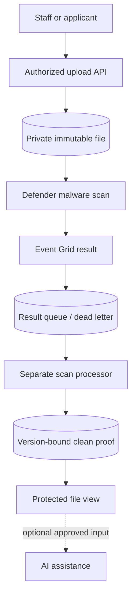

# Architecture and implementation boundaries

## Source-platform context

Staff and applicants needed to upload sensitive documents, see when file checks completed and retrieve only authorized clean versions. Event delivery could be delayed or duplicated, and optional AI processing needed an explicit trust boundary.

- Centralized document handling through Azure Functions, private storage and authorized staff/applicant access paths, including legacy-source ingestion patterns using Logic Apps.
- Built a dedicated scan-result processor, separate from ordinary business requests, with event/container routing, clean-file proofs and protected downloads.
- Added visible file-check states across upload areas so upload acceptance and clean-file availability were distinct outcomes.
- Implemented employee badge portrait preparation with optional AI assistance, fixed-template rendering and protected employee views; kept original identity documents separate from derived artifacts.

## Processing path

## Portable reference boundary

This repository keeps the decision logic small enough to inspect and run. SQLite, temporary files and modeled network decisions replace cloud-side resources where stated. No production identifiers or original employee records are included. The browser dashboard is a loopback-only demonstration, not a hosted multi-user application.

The public implementation borrows the source platform's responsibilities and failure lessons. It does not claim byte-for-byte equality with the Node.js/Azure implementation. Changes of language or backing store are explicitly reference adaptations.

## Trust boundaries

1. Treat user input, scan events and imported files as untrusted data.
2. Validate identity, resource ownership and exact source/version before changing state.
3. Keep privileged workers and deployment identities separate from business API permissions.
4. Preserve failed and unknown outcomes; do not turn absence of evidence into a success.
5. Keep secrets in a managed secret store or local environment, never in Git or screenshots.

## Before a hosted deployment

Review the caller matrix, identity permissions, durable state, concurrency, log redaction and recovery path. Run actual provider integration tests in an isolated environment. Separately review cost, data retention, DNS and rollback. The manual CI validates local contracts only and has no cloud identity or deployment permission.
