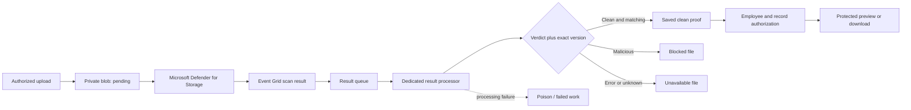

# Azure Malware Scanning & File Quarantine architecture

**Terms used here:** Role-based access control gives people or services permissions according to their roles. DNS turns a service name into the network address used to reach it.

## Business and implementation context

Applicants and employees upload documents into an operational platform. Those files must not become downloadable just because storage accepted them. A malware verdict can arrive late, arrive twice, or refer to bytes that have since been replaced.

- Integrated Defender for Storage scan results with Event Grid, queues and a dedicated Azure Functions processor.
- Bound saved clean-scan results for the exact files to the exact uploaded file and authorized employee/record before previews or downloads.
- Added visible upload/file-check status and documented recovery when the processor is stopped or events fail.

## Processing path

## Implementation layers

| Layer | What is included |
| --- | --- |
| Actual implementation excerpts | TypeScript policy/domain functions and their source tests; no hosted adapter or private record |
| Public local reference | Python demonstration and a loopback dashboard using fictional inputs |
| Infrastructure | Terraform resource boundaries, explicit inputs and mock plan tests |
| Actual cloud evidence | Existing platform context; new nonproduction portal captures are optional follow-up evidence |

## Trust and identity

- The detection engine is Defender for Storage. The Python program consumes fictional verdicts; it is not an antivirus engine.
- Quarantine here means private storage plus denied application retrieval. The reference does not automatically move or delete malicious blobs.
- A clean verdict does not grant access to another employee, and editable blob tags alone are not an authorization authority.
- The optional paid scan service, event delivery and worker shell are separate default-Off infrastructure choices.

## Deployment boundary

Private storage and containers, result/poison queues, Event Grid identity and optional Defender on-upload scanning. The optional Functions Flex shell is Disabled. Host-storage separation, exact RBAC, SQL adapters and private caller routes remain explicit commissioning dependencies.

No resource was applied for this project packaging. A real deployment requires correct identities, network/DNS reachability, permissions, package/schema compatibility and recovery acceptance. The local dashboard is not an internet-facing multi-user application.
